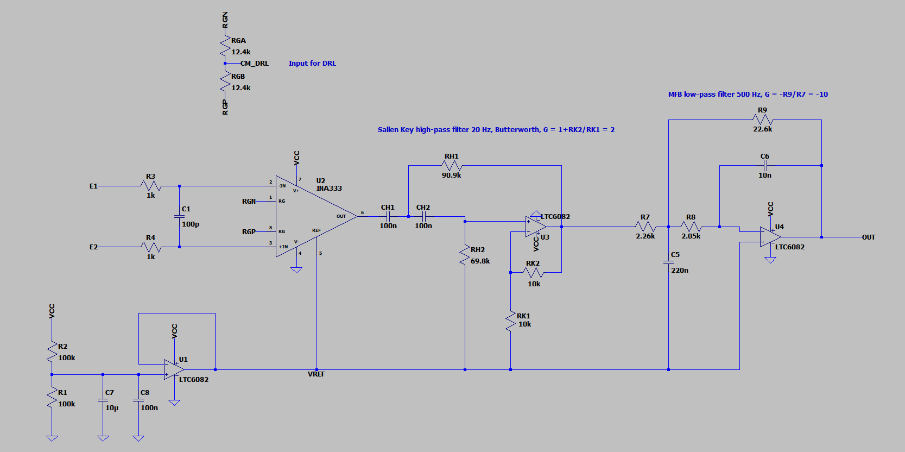

# SpaceFlex


## LTspice simulation

This folder contains the LTspice simulation of the analog front end of our surface EMG acquisition board. The surface EMG signal is tiny (from a few hundred microvolts to a few millivolts, mostly between 20 and 500 Hz) and sits on top of electrode DC offset, 50 Hz mains interference and noise. The circuit amplifies the difference between two electrodes, removes the offset, limits the band and brings the signal to a level the ADC can read.

We designed and validated the chain in LTspice first, then drew the KiCad schematic with the same values.



### Signal chain

**Input RC filter → INA333 → high pass 20 Hz → low pass 500 Hz → ADC**

The circuit runs from a single 3.3 V supply, with the signal centred on 1.65 V.

| Stage | Gain | Pole frequency |
|---|---|---|
| Input RC filter | 1 | 796 kHz |
| INA333 instrumentation amplifier | 5.03 | |
| Sallen Key high pass | 2 | 20 Hz |
| MFB low pass | −10 | 498 Hz |
| **Total** | **≈ 100 (40 dB)** | **band 20 Hz to 500 Hz** |

### Stages and main formulas

#### Input RC filter

R3 = R4 = 1 kΩ and C1 = 100 pF filter out radio frequency interference (phones, WiFi, the ESP32's own radio) before it reaches the amplifier:

```math
f_c = \frac{1}{2\pi\,(R_3+R_4)\,C_1} \approx 796\ \mathrm{kHz}
```

This is far above the EMG band, so the signal is not affected.

#### INA333

The instrumentation amplifier takes the difference between the two electrodes. Its gain is set by RG = RGA + RGB = 24.8 kΩ:

```math
G_{\mathrm{INA}} = 1 + \frac{100\ \mathrm{k\Omega}}{R_G} \approx 5.03
```

The gain is kept low on purpose, so that the electrode DC offset cannot saturate the INA333 before the high pass removes it. The REF pin goes to VREF, so the output sits at 1.65 V. The midpoint between RGA and RGB (`CM_DRL`) will drive the future right leg drive (RLD) circuit.

#### VREF generator

With a single supply, the signal must swing around mid supply. R1 = R2 = 100 kΩ divide the 3.3 V into VREF = 1.65 V, and C7 = 10 µF with C8 = 100 nF filter supply noise:

```math
\tau = (R_1 \parallel R_2)(C_7 + C_8) \approx 0.5\ \mathrm{s}
```

```math
f_c = \frac{1}{2\pi\tau} \approx 0.32\ \mathrm{Hz}
```

An LTC6082 used as a follower buffers VREF, so the INA333 and the filters see a low impedance reference.

#### High pass filter, 20 Hz, gain 2

A second order Sallen Key filter removes the electrode DC offset and the motion artifacts below 20 Hz. With CH1 = CH2 = C = 100 nF, RH1 = 90.9 kΩ, RH2 = 69.8 kΩ and RK1 = RK2 = 10 kΩ:

```math
f_0 = \frac{1}{2\pi\,C\,\sqrt{R_{H1}R_{H2}}} \approx 20\ \mathrm{Hz}
```

```math
K = 1 + \frac{R_{K2}}{R_{K1}} = 2
```

The values give a Butterworth response (Q ≈ 0.71), so the pass band is flat.

#### Low pass filter, 500 Hz, gain −10

A second order multiple feedback (MFB) filter cuts the noise above the EMG band and prevents aliasing at the ADC. With R7 = 2.26 kΩ, R8 = 2.05 kΩ, R9 = 22.6 kΩ, C5 = 220 nF and C6 = 10 nF:

```math
f_0 = \frac{1}{2\pi\sqrt{R_8 R_9 C_5 C_6}} \approx 498\ \mathrm{Hz}
```

```math
H_0 = -\frac{R_9}{R_7} = -10
```

This is also a Butterworth response (Q ≈ 0.71).

#### Total gain

```math
G_{\mathrm{tot}} = G_{\mathrm{INA}} \cdot K \cdot |H_0| \approx 5.03 \cdot 2 \cdot 10 \approx 100 \quad (40\ \mathrm{dB})
```

### AC simulation

The simulation is a frequency sweep from 1 Hz to 100 kHz (`.ac dec 200 1 100k`), with the INA333 model loaded by `.lib INA333.lib`. V1 and V2 have `AC 0.5`, one in phase and one at 180°, so the difference E1 − E2 is 1 V: the plot of `V(OUT)` in dB is directly the gain of the chain.


What you should see:

* about **40 dB (×100)** in the useful band;
* **−3 dB at 19.9 Hz and at 498 Hz**;
* about 28 dB at 1 kHz, with a slope of 40 dB per decade on both sides of the band;
* at 50 Hz the gain is still 40 dB: the filter does not attenuate mains interference, the RLD will reduce it.

### Test with recorded EMG signals

`EMG_E1_LTspice.txt` and `EMG_E2_LTspice.txt` contain a real surface EMG recording, one file per electrode: 2.5 s sampled at 2048 Hz, with a differential signal of up to about 10 mV.

To run this test:

1. In V1, choose **Advanced → PWL FILE** and select `EMG_E1_LTspice.txt`; do the same for V2 with `EMG_E2_LTspice.txt`.
2. Comment out the `.ac` directive and add `.tran 2.7`.
3. Run and plot `V(OUT)`.


What you should see:

* the output is centred on 1.65 V and follows the EMG signal, amplified about 100 times;
* the largest peaks reach about 2.67 V and 0.87 V, well inside the 0 V to 3.3 V range of the ADC;
* when the recording ends at 2.5 s, the output settles back to 1.65 V.


## Kicad implementation
