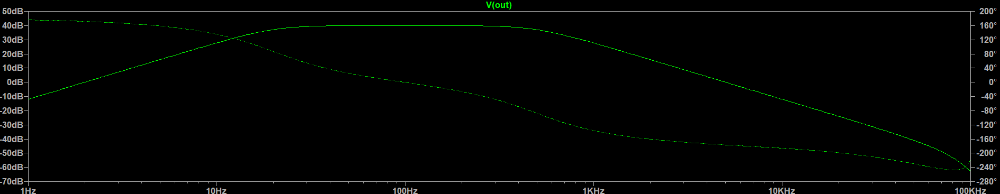
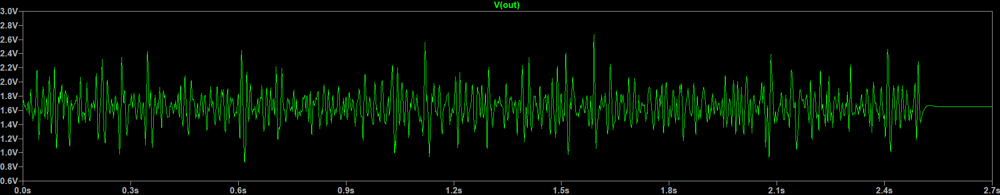

# SpaceFlex
[](LICENSE-HARDWARE)
[](LICENSE-FIRMWARE)
<br><br>

## Overview

**SpaceFlex** is a surface-EMG monitoring system designed to help astronauts and crew medical officers detect muscle deterioration early during long space missions. By combining a custom **4-channel analog front-end** with an **ESP32** and a browser-based console, SpaceFlex tracks each muscle day by day and compares it with the astronaut's own baseline, flagging decline before it shows up on the scale.

## Key Features

- ⚡ **Custom EMG front-end** - 4 simultaneous channels with low-noise instrumentation amplifiers and a 20–500 Hz filter chain.
- 🛡️ **Noise rejection** - Right-leg-drive circuit cancelling mains interference at its source
- 🎯 **Simultaneous sampling** - 24-bit ADC digitizing all four channels at the same instant
- 📉 **Kalman filtering** - Clean, smooth signal with much less lag than a moving average
- 🧍 **Interactive anatomical map** - 11 muscle groups coloured by their latest status (nominal, warning, critical)
- 🧠 **Personalized diagnostics** - Absolute thresholds, % change from Day 1 and consecutive-drop detection
- ⚖️ **Body-weight monitoring** - Automatic alerts when weight drops below baseline
- 🌐 **Offline web console** - Runs entirely in the browser via Web Serial API, no server or internet needed

---

## 👥 Team

- **Raffaele Manfrin**
- **Michele Missiroli**
- **Andrea Nucciotti**
- **Vlad Panta**
- **Riccardo Pica**

---
<br><br>
## LTspice simulation
This [folder](hardware/simulation/) contains the LTspice simulation of the analog front end of our surface EMG acquisition board. The surface EMG signal is tiny (from a few hundred microvolts to a few millivolts, mostly between 20 and 500 Hz) and sits on top of electrode DC offset, 50 Hz mains interference and noise. The circuit amplifies the difference between two electrodes, removes the offset, limits the band and brings the signal to a level the ADC can read.

We designed and validated the chain in LTspice first, then drew the KiCad schematic with the same values.


### Signal chain

**Input RC filter → INA333 → high pass 20 Hz → low pass 500 Hz → ADC**

The circuit runs from a single 3.3 V supply, with the signal centred on 1.65 V.

| Stage | Gain | Pole frequency |
|---|---|---|
| Input RC filter | 1 | 796 kHz |
| INA333 instrumentation amplifier | 5.03 | |
| Sallen Key high pass | 2 | 20 Hz |
| MFB low pass | −10 | 498 Hz |
| **Total** | **≈ 100 (40 dB)** | **band 20 Hz to 500 Hz** |

### Stages and main formulas

#### Input RC filter

R3 = R4 = 1 kΩ and C1 = 100 pF filter out radio frequency interference (phones, WiFi, the ESP32's own radio) before it reaches the amplifier:

```math
f_c = \frac{1}{2\pi\,(R_3+R_4)\,C_1} \approx 796\ \mathrm{kHz}
```

This is far above the EMG band, so the signal is not affected.

#### INA333

The instrumentation amplifier takes the difference between the two electrodes. Its gain is set by RG = RGA + RGB = 24.8 kΩ:

```math
G_{\mathrm{INA}} = 1 + \frac{100\ \mathrm{k\Omega}}{R_G} \approx 5.03
```

The gain is kept low on purpose, so that the electrode DC offset cannot saturate the INA333 before the high pass removes it. The REF pin goes to VREF, so the output sits at 1.65 V. The midpoint between RGA and RGB (`CM_DRL`) will drive the future right leg drive (RLD) circuit.

#### VREF generator

With a single supply, the signal must swing around mid supply. R1 = R2 = 100 kΩ divide the 3.3 V into VREF = 1.65 V, and C7 = 10 µF with C8 = 100 nF filter supply noise:

```math
\tau = (R_1 \parallel R_2)(C_7 + C_8) \approx 0.5\ \mathrm{s}
```

```math
f_c = \frac{1}{2\pi\tau} \approx 0.32\ \mathrm{Hz}
```

An LTC6082 used as a follower buffers VREF, so the INA333 and the filters see a low impedance reference.

#### High pass filter, 20 Hz, gain 2

A second order Sallen Key filter removes the electrode DC offset and the motion artifacts below 20 Hz. With CH1 = CH2 = C = 100 nF, RH1 = 90.9 kΩ, RH2 = 69.8 kΩ and RK1 = RK2 = 10 kΩ:

```math
f_0 = \frac{1}{2\pi\,C\,\sqrt{R_{H1}R_{H2}}} \approx 20\ \mathrm{Hz}
```

```math
K = 1 + \frac{R_{K2}}{R_{K1}} = 2
```

The values give a Butterworth response (Q ≈ 0.71), so the pass band is flat.

#### Low pass filter, 500 Hz, gain −10

A second order multiple feedback (MFB) filter cuts the noise above the EMG band and prevents aliasing at the ADC. With R7 = 2.26 kΩ, R8 = 2.05 kΩ, R9 = 22.6 kΩ, C5 = 220 nF and C6 = 10 nF:

```math
f_0 = \frac{1}{2\pi\sqrt{R_8 R_9 C_5 C_6}} \approx 498\ \mathrm{Hz}
```

```math
H_0 = -\frac{R_9}{R_7} = -10
```

This is also a Butterworth response (Q ≈ 0.71).

#### Total gain

```math
G_{\mathrm{tot}} = G_{\mathrm{INA}} \cdot K \cdot |H_0| \approx 5.03 \cdot 2 \cdot 10 \approx 100 \quad (40\ \mathrm{dB})
```

### AC simulation

The simulation is a frequency sweep from 1 Hz to 100 kHz (`.ac dec 200 1 100k`), with the INA333 model loaded by `.lib INA333.lib`. V1 and V2 have `AC 0.5`, one in phase and one at 180°, so the difference E1 − E2 is 1 V: the plot of `V(OUT)` in dB is directly the gain of the chain.



What you should see:

* about **40 dB (×100)** in the useful band;
* **−3 dB at 19.9 Hz and at 498 Hz**;
* about 28 dB at 1 kHz, with a slope of 40 dB per decade on both sides of the band;
* at 50 Hz the gain is still 40 dB: the filter does not attenuate mains interference, the RLD will reduce it.

### Test with recorded EMG signals

`EMG_E1_LTspice.txt` and `EMG_E2_LTspice.txt` contain a real surface EMG recording, one file per electrode: 2.5 s sampled at 2048 Hz, with a differential signal of up to about 10 mV.

To run this test:

1. In V1, choose **Advanced → PWL FILE** and select `EMG_E1_LTspice.txt`; do the same for V2 with `EMG_E2_LTspice.txt`.
2. Comment out the `.ac` directive and add `.tran 2.7`.
3. Run and plot `V(OUT)`.



What you should see:

* the output is centred on 1.65 V and follows the EMG signal, amplified about 100 times;
* the largest peaks reach about 2.67 V and 0.87 V, well inside the 0 V to 3.3 V range of the ADC;
* when the recording ends at 2.5 s, the output settles back to 1.65 V.

<br><br>

## KiCad schematic

The schematic implements the circuit validated in LTspice, with the same values, repeated for **four identical channels**. On top of the analog chain it adds the parts needed to turn it into a complete board: a right leg drive, an ADC, a microcontroller, separate supplies and protections.

### From the analog chain to the microcontroller

Once each channel has amplified and filtered its signal, the four outputs go to an **ADS131E04**, a 24 bit ADC that samples all four channels at the same instant. VREF goes to the negative input of every ADC channel, so the converter only sees the signal.

The ADC sends the samples to an **ESP32 DevKitC** over **SPI**. A data ready line tells the ESP32, through an interrupt, when a new set of samples is available.

### Right leg drive

The midpoint of each INA333 gain resistor carries the common mode voltage of that channel. A summing amplifier adds the four signals, inverts them and drives the body through the reference electrode:

```math
G_{\mathrm{RLD}} = -\frac{1\ \mathrm{M\Omega}}{390\ \mathrm{k\Omega}} \approx -2.56 \ \text{per channel}
```

This is what attenuates the 50 Hz interference that the filters alone do not remove. A 1 MΩ resistor in series with the output limits the current through the body to a few microamps.

### Separate analog and digital supplies

The analog and digital parts are powered separately, so that the noise of the microcontroller does not reach the amplifiers:

* **+3.3V_A** (analog) comes from an external 3.3 V supply on a screw terminal and powers the amplifiers, the filters, the reference and the analog side of the ADC;
* **+3.3V_D** (digital) comes from the 3.3 V regulator of the ESP32 board and powers the digital side of the ADC.

Every chip has its own decoupling capacitors.

### Protection

* **ESD:** diode arrays on the electrode lines divert electrostatic discharges before they reach the amplifier inputs.
* **EMI:** a metal shield, soldered to ground on the PCB, covers the analog section to keep out the radio interference of the ESP32 and of nearby devices.

## External libraries

| Folder | Content | Source |
|---|---|---|
| `ADS131E04_KiCad/` | ADS131E04 symbol | Made for this project from the [TI datasheet](https://www.ti.com/product/ADS131E04) |
| `Espressif_KiCad/` | ESP32 DevKitC symbol and footprint | [Espressif KiCad libraries](https://github.com/espressif/kicad-libraries) |
| `RF_Shielding.pretty/` | Shielding can footprints | [KiCad footprint library](https://gitlab.com/kicad/libraries/kicad-footprints) |


> [!CAUTION]
> **Electrical Safety Warning**
>
> The electrodes are connected directly to a person, and the board provides no galvanic isolation.
>
> During testing:
> - Power the board exclusively from a battery.
> - **Never connect the ESP32 to a computer powered from the mains while the electrodes are attached.**

<br><br>

## Software

SpaceFlex monitors an astronaut's muscle health by comparing electrical activity (sEMG) from day to day. The signal travels from the ESP32 over USB to a website that runs in the browser, with no server.

```
sEMG sensor → ESP32 → USB serial 115200 baud → browser (login.html → index.html)
```

### 1. Web application

The site has two pages linked through the browser's `localStorage`.

**`login.html`** collects the subject's profile: first name, last name, age, gender, reference body weight, clinical status and notes. The data is saved, then the page moves on to `index.html`. Opening `index.html` directly redirects back to the login.

**`index.html`** is the console. It connects to the ESP32 through the Web Serial API (Chrome or Edge) and reads each line in real time. The main screen is the anatomical map with the history:

- Two SVG silhouettes, front and back, with 11 clickable muscle groups. The colour shows the latest measured status:

  | Colour | Status |
  |---|---|
  | light green | not measured |
  | green | normal |
  | amber | decay |
  | red | atrophy |

- Counters of muscles per status, a multi-day chart of the selected muscle showing the drift from Day 1, and a chronological log of the sessions.

### 2. Diagnostic algorithm

At the end of the acquisition window the site computes the mean $\bar{V}$ and the peak $V_{\mathrm{peak}}$ of the 200 samples, then `classifyLongTermMuscleStatus()` compares them with the history of the same muscle.

**Step 1: baseline.** It takes the first historical measurement of that muscle (usually Day 1), $\bar{V}_{\mathrm{baseline}}$.

**Step 2: percentage change** (in %):

$$
\Delta = \frac{\bar{V}_{\mathrm{today}} - \bar{V}_{\mathrm{baseline}}}{\bar{V}_{\mathrm{baseline}}} \times 100
$$

**Step 3: slope.** It checks the last two days. Calling $V_{d}$ today's value, $V_{d-1}$ yesterday's and $V_{d-2}$ the day before, if $V_{d} < V_{d-1} < V_{d-2}$ the counter $N_{\mathrm{drops}}$ (`consecutiveDrops`) reaches 2.

**Step 4: decision**, starting from the worst case.

| Status | Condition (any one is enough) |
|---|---|
| **Critical** | $\bar{V} < 2.00\ \mathrm{mV}$ or $\Delta \le -25$ |
| **Warning** | $\bar{V} < 3.05\ \mathrm{mV}$ or $\Delta \le -12$ or $N_{\mathrm{drops}} \ge 2$ |
| **Nominal** | none of the above |

So a muscle at 3.25 mV, which is still above the absolute threshold, turns yellow if it has dropped by 14 % from Day 1.

### 3. Stored data

Everything is kept in a JSON object in `localStorage`, with one key per patient (for example `spaceflex_history_valerio_moretti`):

```json
{
  "currentDay": 15,
  "consumedKcal": 1850,
  "consumedProt": 82,
  "weightHistory": [{ "day": 1, "weight": 78.0 }, { "day": 15, "weight": 76.5 }],
  "measurements": [{ "day": 15, "muscleKey": "calves", "mean": "3.15",
                     "peak": "3.42", "baselinePct": "-16.0", "status": "warning", "note": "..." }]
}
```

When the page opens, `JSON.parse` rebuilds the object. At each new measurement the site adds an element at the start of `measurements` (`unshift`) and rewrites everything with `JSON.stringify`.
